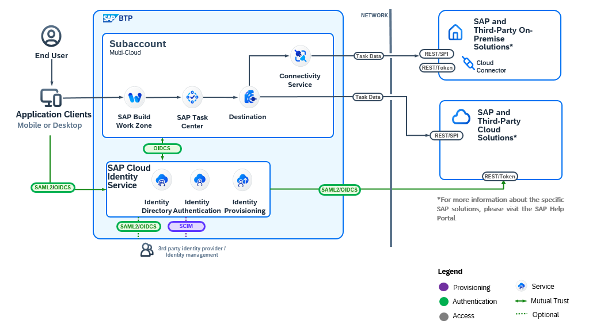

<!-- loio64c01ef0f04046e6946e5588f09ac07e -->

# Solution Architecture

Use the reference architecture diagram to understand the architecture and key components involved in SAP Task Center.

The reference architecture diagram shows the SAP Task Center integration with various task providers. For more information, see [Establish a central inbox with SAP Task Center](https://architecture.learning.sap.com/docs/ref-arch/0245473a99).

