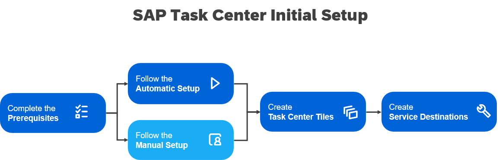

<!-- loio834769400794464489f390350a82bbd6 -->

# Initial Setup

To use the service, make sure you have performed the preliminary setup and meet the prerequisites. Then continue with the initial setup for SAP Task Center, following either the automatic setup \(using a booster\) or the manual setup.

> ### Tip:  
>  The following the step-by-step mission goes through the prerequisites and the initial setup of SAP Task Center: [Establish a Central Inbox with SAP Task Center](https://discovery-center.cloud.sap/missiondetail/3774/3813/) on SAP Discovery Center.

## Setup

1.  Before you start setting up SAP Task Center, you must have completed the prerequisites. For more information, see [Prerequisites](prerequisites-ecc99ef.md).

2.  To set up the SAP Task Center service, either use the booster \(recommended\) or follow the manual steps:

    -   \(Recommended\) Set up the SAP Task Center service using the booster. See [Automatic Setup](automatic-setup-3a49967.md).

    -   Set up the SAP Task Center service manually. See [Manual Setup](manual-setup-0f00d3d.md).

3.  After setting up the SAP Task Center service, create tiles for the SAP Task Center Web app and SAP Task Center Administration app. For more information, see [Create SAP Task Center Tiles](create-sap-task-center-tiles-ddae256.md).
4.  We highly recommend you to set up the SAP Task Center service destinations, as described in [SAP Task Center Service Destinations](sap-task-center-service-destinations-494aa0c.md).

<a name="loio834769400794464489f390350a82bbd6__section_ssw_jb2_2vb"/>

## Next Steps

Once you have completed the initial setup of SAP Task Center, you can continue with setting the connection to the task providers. Fore more information, see [Integrate SAP Task Center with Task Providers](../integrate-sap-task-center-with-task-providers-b158111.md).

