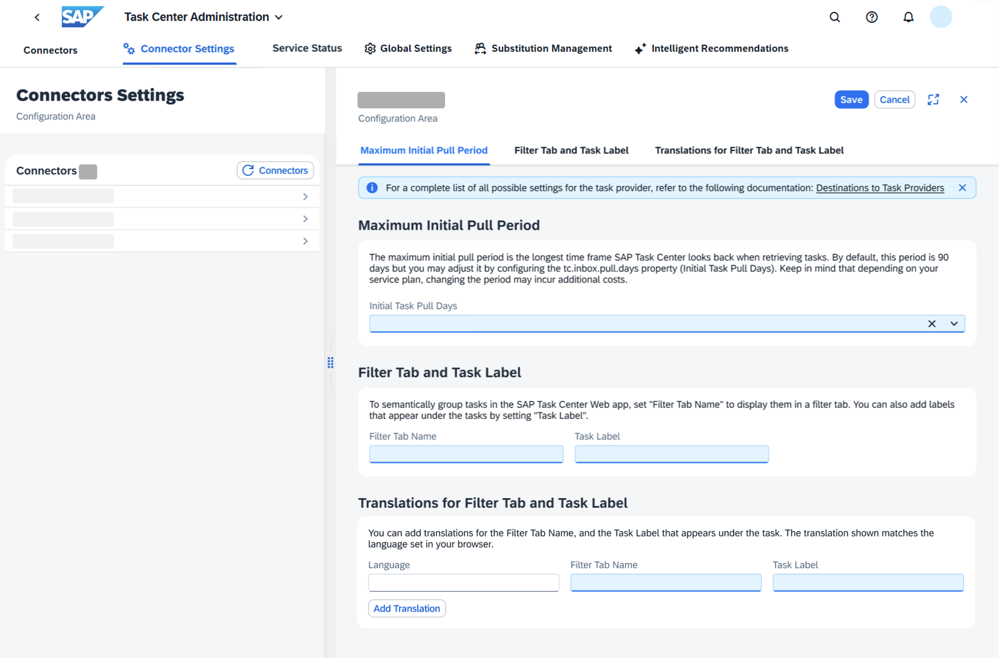

<!-- loio749a5693e6494114ad9288bdf30c4d37 -->

# Connector Settings Tab

Configure the connector settings of your task provider from the SAP Task Center Administration App.

The SAP Task Center Administration App allows you to manage connector settings for your task providers in the *Connector Settings* tab.

When you modify the settings of a connector in the SAP Task Center Administration App, this change is automatically synchronized with the destination in the SAP BTP Cockpit. The same applies in reverse - when you modify the properties from the SAP BTP Cockpit, the change is automatically synchronized with the SAP Task Center Administration App.

## Prerequisites

You must create a destination for each task provider in your Cloud Foundry subaccount. For more information, see [Integrate SAP Task Center with Task Providers](../integrate-sap-task-center-with-task-providers-b158111.md).

> ### Note:  
> You cannot create destinations through the SAP Task Center Administration App.

> ### Tip:  
> If you use the automatic setup, the booster automatically creates sample destinations for the task providers. For more information, see [Automatic Setup](../30-initial-setup/automatic-setup-3a49967.md#loio3a499676e7ae4282af84092f778e3737__result_mfw_42y_j4b).

## Working with the *Connector Settings*Tab

The *Connector Settings* tab provides the following settings:

**Available Settings in the Connector Settings Tab**

<table>
<tr>
<th valign="top">

Setting

</th>
<th valign="top">

Description

</th>
</tr>
<tr>
<td valign="top">

*Maximum Initial Pull Period*

</td>
<td valign="top">

The maximum initial pull period is the longest time frame that SAP Task Center uses to look back when retrieving tasks. By default, this period is 90 days. You can change it by configuring *Initial Task Pull Days* \(corresponds to the *tc.inbox.pull.days*\).

For details, refer to [Integrate SAP Task Center with Task Providers](../integrate-sap-task-center-with-task-providers-b158111.md).

> ### Remember:  
> Changing the period may result in additional costs, depending on your service plan. For details, refer to [Service Plans and Metering](../10-what-is/service-plans-and-metering-7b6b689.md).

</td>
</tr>
<tr>
<td valign="top">

*Filter Tab and Task Label*

</td>
<td valign="top">

You can group tasks in the SAP Task Center Web App by adding a *Filter Tab Name* \(corresponds to the *tc.ui.group* property\).

You can add a label under each task by setting *Task Label* \(corresponds to the *tc.ui.label* property\).

For more information about configuring filter tabs, see [Configure Filter Tabs in the SAP Task Center Web App](configure-filter-tabs-in-the-sap-task-center-web-app-53157da.md).

For more information about configuring task labels, see [Configure Labels in SAP Task Center Web App](configure-labels-in-sap-task-center-web-app-a0be9ad.md).

</td>
</tr>
<tr>
<td valign="top">

*Translations for Filter Tab and Task Label*

</td>
<td valign="top">

You can add translations for the filter tab name \(corresponds to the *tc.ui.group.\[language\_code\]* property\) and the task label \(corresponds to the *tc.ui.label.\[language\_code\]* property\) to display them in different languages.

For more information about translations for filter tabs, see [Configure Filter Tabs in the SAP Task Center Web App](configure-filter-tabs-in-the-sap-task-center-web-app-53157da.md).

For more information about translations for the task label, see [Configure Labels in SAP Task Center Web App](configure-labels-in-sap-task-center-web-app-a0be9ad.md).

</td>
</tr>
</table>

