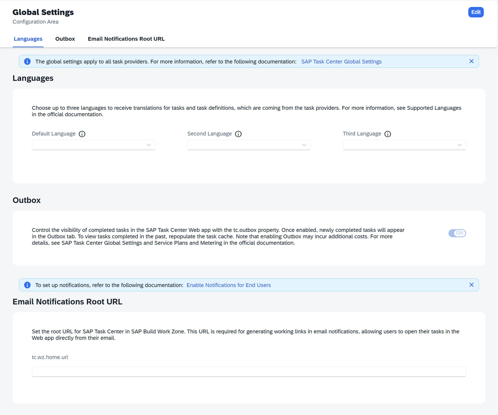

<!-- loio771e6e14f593496c8946fdf01589a926 -->

# Global Settings Tab

Configure the global settings for the SAP Task Center Web App from the SAP Task Center Administration App.

The SAP Task Center Administration App allows you to manage global settings for your task providers in the *Global Settings* tab.

When you modify the global settings in the SAP Task Center Administration App, this change is automatically synchronized with the *Task\_Center\_global\_settings* destination in the SAP BTP Cockpit. The same applies in reverse - when you modify the global settings in the *Task\_Center\_global\_settings* destination in the SAP BTP Cockpit, the change is automatically synchronized with the SAP Task Center Administration App.

## Prerequisites

You have created a *Task\_Center\_global\_settings* destination in your Cloud Foundry subaccount. For more information, see [SAP Task Center Global Settings](../30-initial-setup/sap-task-center-global-settings-99e5302.md).

> ### Note:  
> You cannot create destinations through the SAP Task Center Administration App.

> ### Tip:  
> If you use the automatic setup, the booster automatically creates sample destinations for the task providers. For more information, see [Automatic Setup](../30-initial-setup/automatic-setup-3a49967.md#loio3a499676e7ae4282af84092f778e3737__result_mfw_42y_j4b).

## Using the Global Settings Tab

The *Global Settings* tab allows you to modify the following settings:

**Available Settings in the Connector Settings Tab**

<table>
<tr>
<th valign="top">

Setting

</th>
<th valign="top">

Description

</th>
</tr>
<tr>
<td valign="top">

*Languages*

</td>
<td valign="top">

Allows you to pick up to 3 languages for the translations of tasks and task definitions. For more information, see [Technical Restrictions](../10-what-is/conventions-and-technical-restrictions-f0f13bf.md#loiof0f13bf49e3f45488bcf24218a2771e4__section_q4p_zk5_ymb).

</td>
</tr>
<tr>
<td valign="top">

*Outbox*

</td>
<td valign="top">

Allows you to enable or disable the *Outbox* tab in the Web app which shows completed tasks. For more information, see [SAP Task Center Global Settings](../30-initial-setup/sap-task-center-global-settings-99e5302.md).

</td>
</tr>
<tr>
<td valign="top">

*Email Notifications Root URL*

</td>
<td valign="top">

Allows you to set the root URL that is used for generating working links in email notifications. For more information, see [Enable Notifications for End Users](enable-notifications-for-end-users-caf2543.md).

</td>
</tr>
</table>

For more information on each setting, see [SAP Task Center Global Settings](../30-initial-setup/sap-task-center-global-settings-99e5302.md).

**Related Information**  

[SAP Task Center Global Settings](../30-initial-setup/sap-task-center-global-settings-99e5302.md "Configure the Task_Center_global_settings destination, to set the properties valid for all destinations.")

