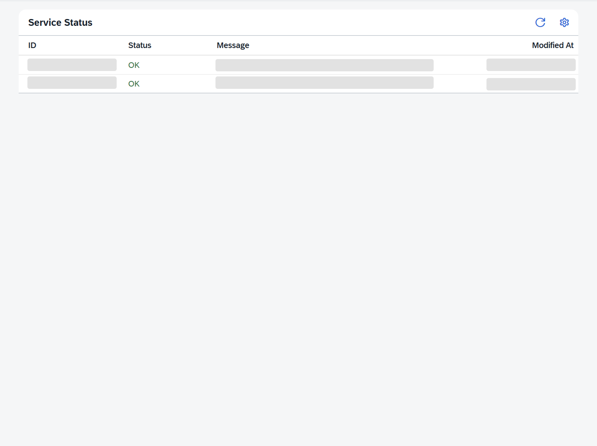

<!-- loioc081fdc94b1d4606bb4d75054db460fb -->

<link rel="stylesheet" type="text/css" href="../css/sap-icons.css"/>

# Service Status Tab

Monitor the status of SAP Task Center Service destinations.

## Using the*Service Status* Tab

The *Service Status* tab provides information about the current status of the following destinations:

-   *Task\_Center\_global\_settings* 
-   *Identity\_Authentication\_Connectivity\_IDS* 

The related end point in the API is `/task-center-service/v1/service-status`.

Use the *Refresh* button \(\) to get the latest status.

> ### Note:  
> The IDs and all messages returned by the SAP Task Center service are only in English.
> 
> **Information in the Service Status Table**
> 
> 
> <table>
> <tr>
> <th valign="top">
> 
> Column
> 
> </th>
> <th valign="top">
> 
> Details
> 
> </th>
> </tr>
> <tr>
> <td valign="top" rowspan="2">
> 
> *ID* 
> 
> </td>
> <td valign="top">
> 
> The *Service\_Configuration* ID is related to the *Task\_Center\_global\_settings* destination. See also [SAP Task Center Global Settings](../30-initial-setup/sap-task-center-global-settings-99e5302.md).
> 
> </td>
> </tr>
> <tr>
> <td valign="top">
> 
> The *IDS\_Configuration* ID is related to the *Identity\_Authentication\_Connectivity\_IDS* destination. See also [Identity Directory Connectivity](../30-initial-setup/identity-directory-connectivity-3dcfba9.md).
> 
> </td>
> </tr>
> <tr>
> <td valign="top">
> 
> *Status* 
> 
> </td>
> <td valign="top">
> 
> The service can have the following status:
> 
> -   *OK* 
> -   *WARNING* 
> -   *ERROR* 
> 
> For more information, see the message.
> 
> > ### Note:  
> > Only the last retrieved status is displayed.
> 
> 
> 
> </td>
> </tr>
> <tr>
> <td valign="top">
> 
> *Message* 
> 
> </td>
> <td valign="top">
> 
> Displays a message returned by the service.
> 
> </td>
> </tr>
> <tr>
> <td valign="top">
> 
> *Modified At* 
> 
> </td>
> <td valign="top">
> 
> Date and time when the last status update was retrieved.
> 
> </td>
> </tr>
> </table>

**Related Information**  

[SAP Task Center Global Settings](../30-initial-setup/sap-task-center-global-settings-99e5302.md "Configure the Task_Center_global_settings destination, to set the properties valid for all destinations.")

[Identity Directory Connectivity](../30-initial-setup/identity-directory-connectivity-3dcfba9.md "Configure the Identity_Authentication_Connectivity_IDS destination to connect to the identity directory of Identity Authentication and retrieve the required information about the end users.")

