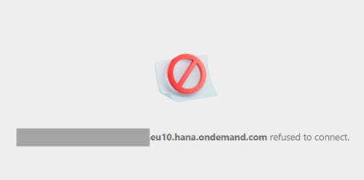
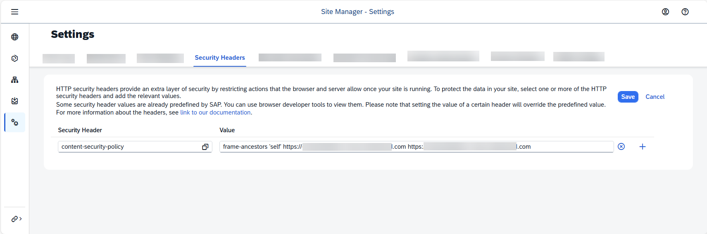
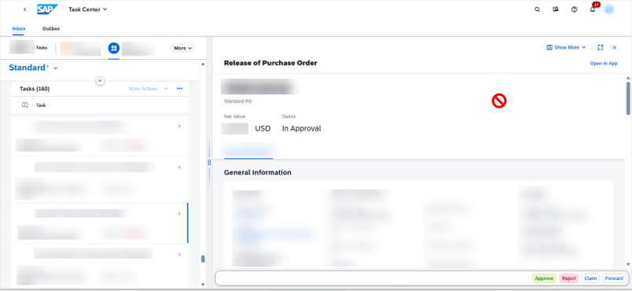

<!-- loio306702ce11a1446187d30c57ad748a2a -->

<link rel="stylesheet" type="text/css" href="../css/sap-icons.css"/>

# Troubleshooting an Error in Task Details

Steps for SAP Task Center Administrators to troubleshoot and resolve issues in the task details.

## Error "<link\> refused to connect"

### Symptom

You are using SAP Task Center and a task provider in different subaccounts, or in the same subaccount but with different domains. SAP Task Center uses an iframe to embed a My Inbox task from the task provider, for example an SAP Build Process Automation task. When you open the task details in the Web app, you see no details, but the following error:

*"<link\> refused to connect."*

### Reason

The provider domain is not listed as a trusted domain in the SAP BTP cockpit.

### Solution

1.  In your central point of entry for accessing applications, add the frames that should be embedded as security headers. For more information, see [How to configure the security headers](https://help.sap.com/docs/build-work-zone-standard-edition/sap-build-work-zone-standard-edition/using-security-headers#how-to-configure-the-security-headers).

    > ### Example:  
    > *Security Header*:
    > 
    > `content-security-policy` 
    > 
    > *Value*:
    > 
    > `frame-ancestors 'self' https://<domainName>.*.com`

    

2.  \(Optional\) Configure the domain of the SAP Task Center Web app as the trusted domain in the provider subaccount.

    > ### Note:  
    > This step is required if SAP Task Center and the task provider are in different subaccounts or have different domains.

    For more information, see the respective documentation of your central point of entry for accessing applications.

    For example, see [Single Tenant Business Solution](https://help.sap.com/docs/build-work-zone-standard-edition/sap-build-work-zone-standard-edition/single-tenant-business-solution) \> *Configure Trusted Domains in Provider Subaccount* for SAP Build Work Zone, standard edition, or [Single Tenant Business Solution](https://help.sap.com/docs/build-work-zone-advanced-edition/sap-build-work-zone-advanced-edition/single-tenant-business-solution) \> *Configure Trusted Domains in Provider Subaccount* for SAP Build Work Zone, advanced edition.

    > ### Example:  
    > Example for the domain: `https://<saptaskcenterdomain>.launchpad.cfapps.<datacenter>.hana.ondemand.com`

## Blocked Mouse in Task Details

### Symptom

You are using the SAP Task Center Web app to open a task embedded in an iframe \(for example an SAP S/4HANA task\). When you open the task details, the embedded content cannot be accessed because the mouse is blocked \(\), indicating that access is restricted or forbidden.

### Reason

The embedding is blocked because the allowlist service of the task provider system does not allow framing.

### Solution

Depending on the task provider system, make sure that you use an allowlist for clickjacking framing protection.

For example, see [Maintain Protection Allowlists](https://help.sap.com/docs/SAP_S4HANA_CLOUD/55a7cb346519450cb9e6d21c1ecd6ec1/81aed02afbdb41379fe0eb4b23f7756a.html) for SAP S/4HANA Cloud Public Edition as a task provider.

## SAP Task Center Applications Fail to Load \(Error 500\)

### Symptom

The SAP Task Center Web app and SAP Task Center Administration app fail to load completely, showing a continuous loading screen or "busy" icon. Back-end logs or developer tools show an *HTTP 500 Internal Server Error*.

This is valid if you are accessing the SAP Task Center API using direct authentication via SAP Cloud Identity Services - Identity Authentication. For more information, see [Access the SAP Task Center API Using Identity Authentication](../40-administration/access-the-sap-task-center-api-using-identity-authentication-c45c4c3.md).

### Reason

The connection between the SAP BTP subaccount and the Identity Authentication application failed due to a renaming of the SAP Task Center Identity Authentication application API.

### Solution

Remove the current subscription and create a new one to SAP Task Center in your SAP BTP subaccount. This updates the connection to use the new API name. For more information, see [Create a Subscription to the SAP Task Center Service](../30-initial-setup/create-a-subscription-to-the-sap-task-center-service-fd137e3.md).

> ### Note:  
> Deleting the subscription also removes all configured dependencies from the application in your Identity Authentication tenant, such as role collection mappings. You need to reconfigure these manually after the new subscription is active.

